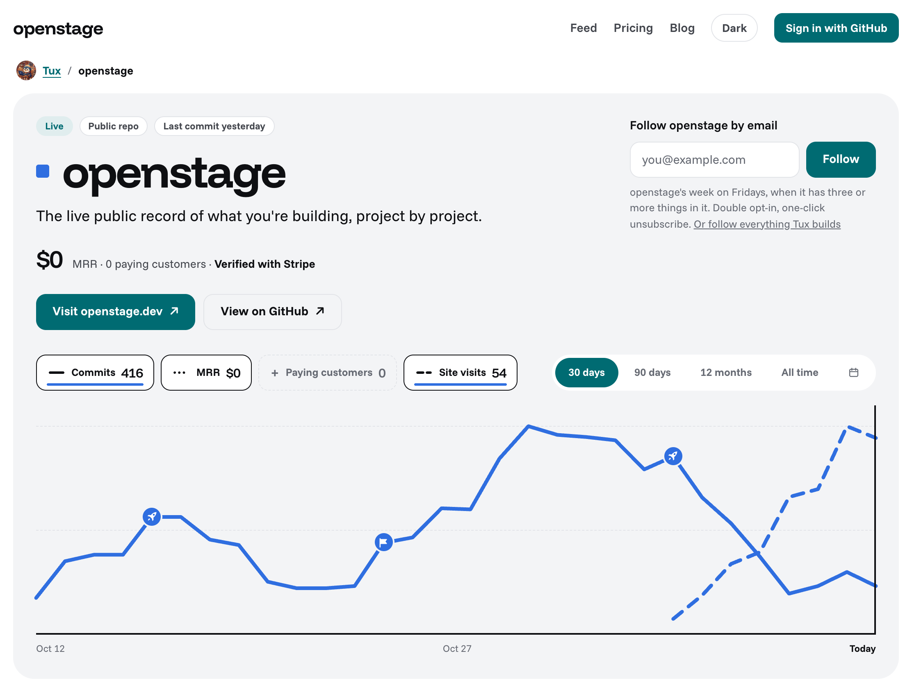

[](https://openstage.dev/tuxnotfound)

# Openstage

<a href="https://openstage.dev/tuxnotfound/openstage">
  <picture>
    <source media="(prefers-color-scheme: dark)" srcset="doc/readme/project-page-dark.png">
    
  </picture>
</a>

Openstage is the live public record of what you're building, project by project.

Each project gets a page. It shows:

- What shipped, from GitHub: commits and releases sync on their own.
- Site visits, from one script tag on your site, with no cookies.
- MRR, read from Stripe with a read-only key.

A live page: [openstage.dev/tuxnotfound/openstage](https://openstage.dev/tuxnotfound/openstage). Make your own at [openstage.dev](https://openstage.dev).

## README badge

The badge at the top of this page, for your own README:

```md
[](https://openstage.dev/YOUR_USERNAME)
```

## Running it locally

It needs:

- Ruby 3.4.12 and Node 22.23.0
- Postgres
- libvips, for the preview cards and the weekly email's chart
- A GitHub OAuth App for sign-in, with the callback URL `http://localhost:3000/auth/github/callback`

```bash
bin/setup      # gems and the database
npm install    # the charts
bin/dev        # http://localhost:3000
```

Environment variables go in `.env`:

| Variable | For |
|---|---|
| `GITHUB_CLIENT_ID`, `GITHUB_CLIENT_SECRET` | Sign-in, from the OAuth App. Required. |
| `GITHUB_APP_SLUG`, `GITHUB_APP_CLIENT_ID`, `GITHUB_APP_PRIVATE_KEY`, `GITHUB_APP_WEBHOOK_SECRET` | Private repos, through a GitHub App with read access to Contents, Metadata, Pull requests and Deployments. |
| `STRIPE_SECRET_KEY`, `STRIPE_WEBHOOK_SECRET`, `STRIPE_MONTHLY_PRICE_ID` | The Pro checkout. |

Tests run with `bundle exec rspec` and `npm test`.

Running it in production is not documented yet. The hosted version is at [openstage.dev](https://openstage.dev).

## Licence and stack

[MIT](LICENSE). Rails, Postgres, Hotwire, Tailwind and Solid Queue, with the charts in React and TypeScript.
